

  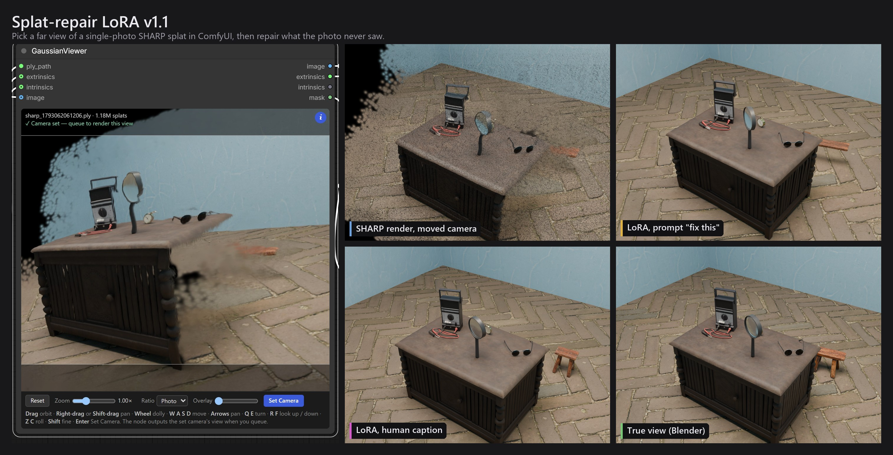

Test scene t2. No training run or selection step used it.

# Splat-repair LoRA

A LoRA for [Qwen-Image-2.1](https://huggingface.co/Qwen/Qwen-Image-2.1) that repairs a far view rendered from a single-photo 3D Gaussian splat reconstruction ([SHARP](https://github.com/apple/ml-sharp)).

It fills holes and smears in the parts of the view the photo never saw, using the original photo as a reference.

This repository also has a ComfyUI node for choosing that far view, [GaussianViewer (rebuild)](comfyui-gaussian-viewer/). It is based on CarlMarkswx's GaussianViewer, and you can install it from ComfyUI Manager.

## Why

SHARP turns one photo into a 3D Gaussian splat. Move the camera away from where the photo was taken, and the parts the photo never saw come out as holes and smears. An image-edit model can paint them back in. [dx8152's Qwen-Image-Edit-2511-Gaussian-Splash](https://huggingface.co/dx8152/Qwen-Image-Edit-2511-Gaussian-Splash) LoRA showed that, and it was the starting point for this project. This LoRA does the same job on Qwen-Image-2.1. It was trained on SHARP's actual renders, each paired with the true view from Blender.

## Use

**[Download the LoRA](https://github.com/aaljman/splat-repair-lora/releases/download/v1.1/splat_repair_human_qwen21_e23.safetensors)** (`splat_repair_human_qwen21_e23.safetensors`, rank 8, alpha 8, 42 MB) from the [v1.1 release](https://github.com/aaljman/splat-repair-lora/releases/tag/v1.1) and put it in ComfyUI's `models/loras/`. The file is also in the repo, so "Download ZIP" or a clone gets it too.

There are three LoRAs. They share the same training pairs and settings, and only the training caption differs, so each one expects its own kind of prompt.

| LoRA | What you type |
| --- | --- |
| **Human caption** (use this one) | a short, plain description of what is broken or hidden and what should be there |
| Detail caption | a long (about 300 words) object-by-object description of the whole scene |
| Constant caption | just `fix this` |

The other two exist to measure how much the prompt matters. The human caption is best or level on every measure. [Caption styles](#caption-styles) explains why there are three and has the comparison sheets and the scores.

Each repair takes two images and a prompt.

| Input | What it is |
| --- | --- |
| **Image 1** | SHARP's render at the new camera |
| **Image 2** | the original photo |
| **Prompt** | a short, plain description of what the hidden or broken parts should look like (see `examples/`) |

This is the prompt for the scene at the top, from `examples/t2_prompt.txt`:

> The right end of the cabinet table and the floor behind it got smeared. There's a little rustic wooden stool with an orange-brown top just past the table's right end, and the herringbone brick floor and pale blue walls carry on around it and on the left side of the room.

### ComfyUI

`workflow_api.json` is the API-format graph behind every result below. Load the two images and write the prompt.

| Setting | Value |
| --- | --- |
| Steps | 25 |
| CFG | 1.0 |
| Sampler / scheduler | euler / simple |
| LoRA strength | 1.0 |

The graph needs the Qwen-Image-2.1 nodes (`TextEncodeQwenImage21`, `QwenImage21Cache`) and names int8 model files. Swap in your own model files as needed.

### Picking the far view in ComfyUI

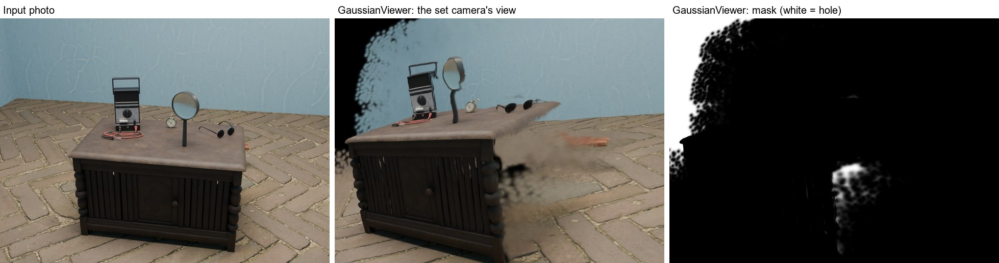

The [GaussianViewer (rebuild)](comfyui-gaussian-viewer/) node makes Image 1. Feed it SHARP's PLY, extrinsics and intrinsics from [ComfyUI-Sharp](https://github.com/PozzettiAndrea/ComfyUI-Sharp). Orbit the splat inside the node, press **Set Camera**, and queue again. The node outputs that view at the photo's resolution, with a hole mask and the camera matrices.

It is a from-scratch rebuild of [CarlMarkswx/comfyui-GaussianViewer](https://github.com/CarlMarkswx/comfyui_GaussianViewer). It has its own WebGL2 renderer and parses the PLY in a background worker, in 199 ms against the original's 663 ms for a 1.18M-splat file. The workflow saves its camera. It keeps the original's node name and inputs, so disable the original before you install it.

To install it, pick one:

- In ComfyUI Manager, search for **GaussianViewer (rebuild)**.
- Run `comfy node install gaussian-viewer-rebuild`.
- Unpack `comfyui-gaussian-viewer-2.0.0.zip` from the [v1.1 release](https://github.com/aaljman/splat-repair-lora/releases/tag/v1.1) into `ComfyUI/custom_nodes/`.

The node's [README](comfyui-gaussian-viewer/README.md) lists the controls, the outputs and the changes from the original.

The pack also has a **Fill Splat Holes** node. It fills the holes by smearing in the surrounding colours (push-pull), the same fill the training inputs got. On the dataset renders its output matches the training fill pixel for pixel, so put it between GaussianViewer and the LoRA.

### Full workflow on a real photo

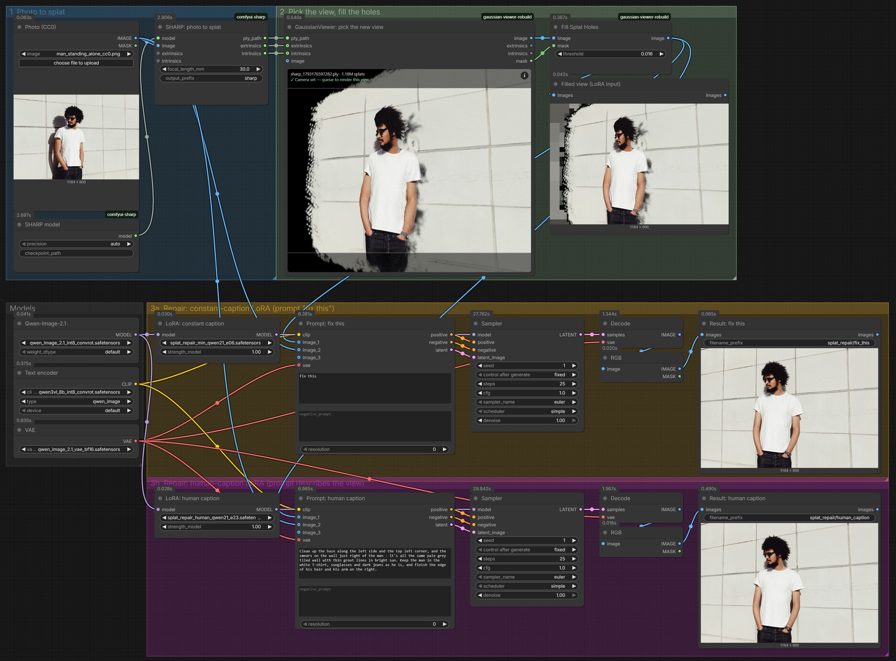

[`workflow_photo_to_repair.json`](workflow_photo_to_repair.json) is the whole pipeline in one graph: photo, SHARP, GaussianViewer, Fill Splat Holes, then both LoRAs side by side. Drag it onto the ComfyUI canvas, and put [`examples/man_standing_alone_cc0.png`](examples/man_standing_alone_cc0.png) in ComfyUI's `input/` folder to run it as shown. The human-caption prompt is in [`examples/man_standing_alone_prompt.txt`](examples/man_standing_alone_prompt.txt). It needs ComfyUI-Sharp, this repository's node pack, the Qwen-Image-2.1 files and the LoRAs.

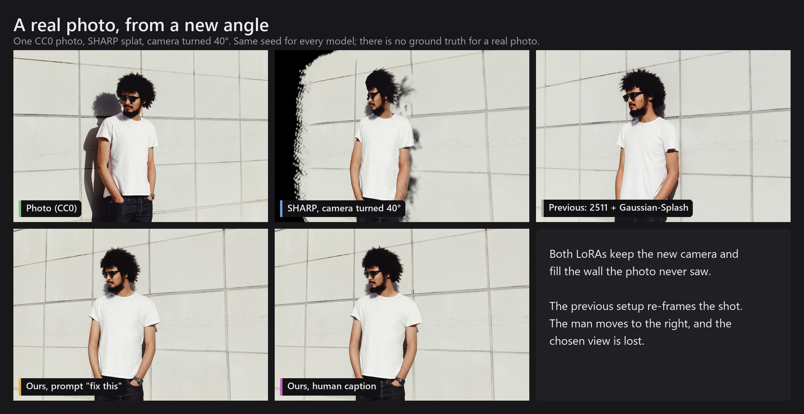

The photo is a real one, so there is no ground truth and no score. It is one example, not a test. Both LoRAs keep the turned camera and fill the wall. The previous setup (Qwen-Image-Edit-2511 with the Gaussian-Splash LoRA, run the same way as in [the comparison below](#compared-with-the-previous-lora)) re-frames the shot and moves the man to the right of the frame.

## Compared with the previous LoRA

The baseline is the setup used before this project: Qwen-Image-Edit-2511 with **[dx8152/Qwen-Image-Edit-2511-Gaussian-Splash](https://huggingface.co/dx8152/Qwen-Image-Edit-2511-Gaussian-Splash)** (Apache-2.0), 4-step Lightning sampling and that LoRA's default prompt. That LoRA was the starting point for this idea, because it showed that an image-edit model can repair SHARP renders. All credit for it goes to dx8152.

Each sheet shows, left to right, the Blender ground truth, SHARP's render, the previous setup and this LoRA. No training run or selection step used test scenes t1 to t5.

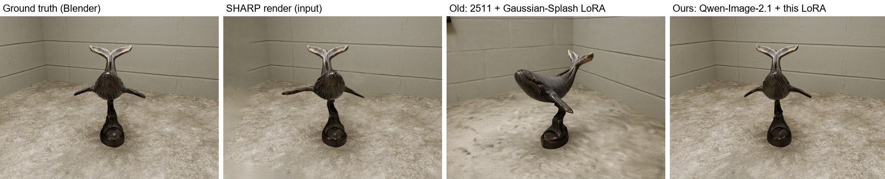

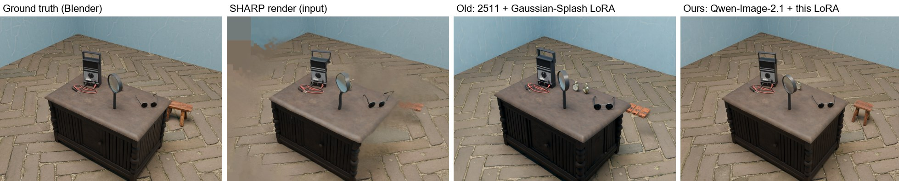

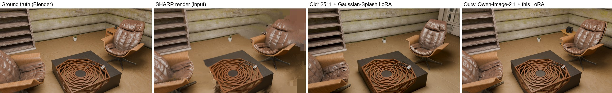

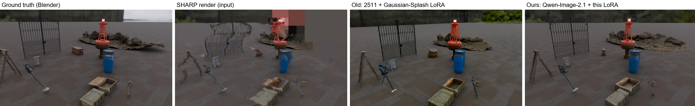

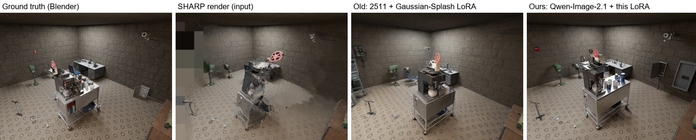

The validation scenes decided the epoch and the caption style, so their scores are optimistic. They are [x001](compare/x001.jpg), [y05](compare/y05.jpg), [y18](compare/y18.jpg) and [y31](compare/y31.jpg).

## Scores

PSNR is in dB against the true Blender view, given as whole frame / only the pixels the photo never saw. Higher is better.

| Scene | SHARP render | Previous (2511 + Gaussian-Splash) | Qwen-Image-2.1, no LoRA, detailed prompt | Qwen-Image-2.1, no LoRA, same prompt | This LoRA |
| --- | ---: | ---: | ---: | ---: | ---: |
| t1 | 22.8 / 23.3 | 19.1 / 19.5 | 20.1 / 20.1 | 20.2 / 20.2 | 24.0 / 25.0 |
| t2 | 19.9 / 18.8 | 19.3 / 19.6 | 16.1 / 18.3 | 16.9 / 18.9 | 21.1 / 22.0 |
| t3 | 18.1 / 17.9 | 16.8 / 17.6 | 13.7 / 14.3 | 17.7 / 18.3 | 17.7 / 19.1 |
| t4 | 18.1 / 19.7 | 16.3 / 20.3 | 15.3 / 12.9 | 15.9 / 16.8 | 16.8 / 20.7 |
| t5 | 20.0 / 18.6 | 18.1 / 17.8 | 16.6 / 17.0 | 14.7 / 15.3 | 19.4 / 18.6 |
| **mean, test** | **19.78 / 19.65** | **17.90 / 18.95** | **16.36 / 16.52** | **17.06 / 17.92** | **19.80 / 21.08** |
| mean, validation | 19.26 / 17.52 | 16.43 / 15.28 | 15.87 / 15.52 | 15.84 / 14.97 | 19.68 / 18.76 |

How to read these:

- This table uses one training seed and one sampling seed per scene, on 5 test scenes. In the unseen region this LoRA is +1.43 dB over SHARP's render (4 of 5 scenes), but the 95% interval (-0.03 to +2.89 dB) includes zero. Over the whole frame it is level with SHARP's render, and SSIM is lower on every scene.
- It has higher PSNR than the previous setup on all 9 scenes. That comparison changes the base model, the LoRA, the step count and the prompt all at once, so it compares two setups, not two LoRAs. The previous setup also got a hole-filled version of the SHARP render.
- With the same human prompt and no LoRA, the base model scores 17.06 / 17.92 dB on the test scenes. This LoRA is higher on all 5 test scenes, by 2.74 dB over the whole frame and 3.16 dB in the unseen region (95% interval 1.35 to 4.98). SSIM is also higher on all 5 (0.546 vs 0.450). That is the cleanest measure of what the LoRA itself adds, though it is still one seed on 5 scenes.
- All scored scenes are synthetic (Blender and Poly Haven). The one real photo above has no ground truth, so it has no score.

Three sampling seeds (next section) give the same picture. In the unseen region this LoRA is +1.44 dB over SHARP's render (95% interval -0.11 to +2.98) and +3.33 dB over the base model with the same prompt (95% interval +1.06 to +5.60). It is level with SHARP's render over the whole frame, and its SSIM is lower on all 15 scene-seed pairs.

## Caption styles

The three LoRAs share the same 38 training pairs and the same settings. Only the training caption changed, so each one expects a different prompt. The human-caption LoRA above is the one to use. The other two are here so anyone can check the comparison.

The three captions measure how much of the repair comes from the prompt.

- **Constant caption.** The text carries no information, so the LoRA learns everything from the two images.
- **Human caption.** This is what a user would type.
- **Detail caption.** It says close to everything text can say about the scene. At 295 words on average against 46, it is about six times as long as a human caption, so it shows whether more text keeps helping.

The scores below answer it. A short description beats `fix this` on the perceptual measures (LPIPS and DISTS), and by 0.8 dB PSNR on the pixels the photo never saw, though that interval crosses zero. Six times more text adds nothing measurable over the short description.

| LoRA | Trained with | Prompt it with | Epoch | File |
| --- | --- | --- | ---: | --- |
| **Human caption** | a short, plain description of what is broken or hidden and what should be there | the same kind of description, e.g. `examples/t2_prompt.txt` | 23 of 40 | [`splat_repair_human_qwen21_e23.safetensors`](https://github.com/aaljman/splat-repair-lora/releases/download/v1.1/splat_repair_human_qwen21_e23.safetensors) |
| Detail caption | a long, object-by-object description of the whole scene: the camera move, every object, the lighting, and which areas were hidden or out of frame | the same kind of description, e.g. `examples/t2_prompt.detail.txt` (about 300 words) | 25 (run stopped at 37) | [`splat_repair_detail_qwen21_e25.safetensors`](https://github.com/aaljman/splat-repair-lora/releases/download/v1.1/splat_repair_detail_qwen21_e25.safetensors) |
| Constant caption | the words `fix this` on every pair | exactly `fix this` | 6 of 16 | [`splat_repair_min_qwen21_e06.safetensors`](https://github.com/aaljman/splat-repair-lora/releases/download/v1.1/splat_repair_min_qwen21_e06.safetensors) |

All three are rank 8, alpha 8 and 42 MB, and they use the same ComfyUI graph and settings. Change the `lora_name` in `workflow_api.json` to switch. The constant-caption file keeps the trainer's `fix this` trigger in its header, because that is its prompt. The other two have it removed.

Each sheet shows, left to right, the Blender ground truth, SHARP's render, then the constant, detail and human-caption LoRAs. They use sampling seed 1 on the test scenes.

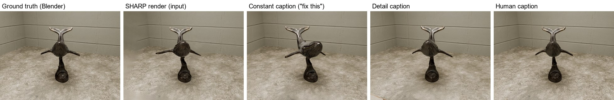

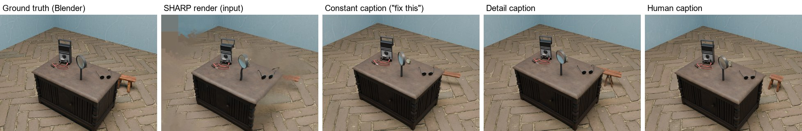

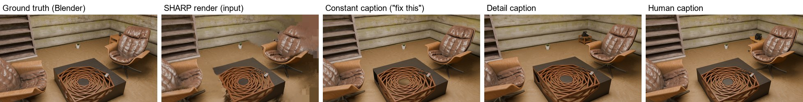

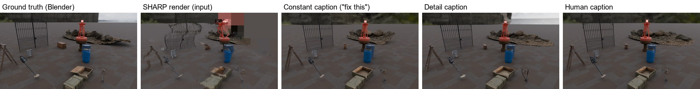

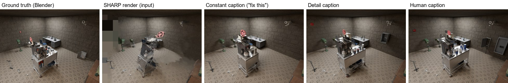

### Scores over three seeds

Each LoRA ran with three sampling seeds per scene. Each cell averages the seeds per scene, then averages the scenes. PSNR is in dB, given as whole frame / only the pixels the photo never saw. Higher is better for PSNR and SSIM, lower for LPIPS (VGG) and DISTS.

| Method | Test PSNR | Test SSIM | Test LPIPS | Test DISTS | Validation PSNR | Validation LPIPS |
| --- | ---: | ---: | ---: | ---: | ---: | ---: |
| SHARP render (input) | 19.78 / 19.65 | 0.588 | 0.482 | 0.177 | 19.26 / 17.52 | 0.475 |
| Qwen-Image-2.1, no LoRA, human prompt | 17.09 / 17.76 | 0.472 | 0.510 | 0.181 | 16.23 / 14.94 | 0.512 |
| Constant caption, e6 | 19.09 / 20.26 | 0.522 | 0.432 | 0.131 | 18.66 / 17.72 | 0.402 |
| Detail caption, e25 | **19.74** / 20.10 | 0.529 | 0.426 | 0.119 | 19.03 / 18.18 | 0.400 |
| **Human caption, e23** | 19.63 / **21.09** | **0.545** | **0.397** | **0.118** | **19.53** / **18.66** | **0.382** |

The next table pairs the human caption with each other style on the test scenes. "Wins" counts scene-seed pairs (5 scenes × 3 seeds). The 95% interval is over the 5 scenes, each averaged over its seeds.

| Human caption vs | Metric | Wins | Mean difference | 95% interval |
| --- | --- | ---: | ---: | ---: |
| Detail caption | PSNR, unseen | 12/15 | +0.99 dB | -0.24 to +2.22 |
| Detail caption | PSNR, whole frame | 9/15 | -0.11 dB | -2.71 to +2.48 |
| Detail caption | LPIPS | 12/15 | -0.029 | -0.085 to +0.026 |
| Constant caption | PSNR, unseen | 10/15 | +0.83 dB | -0.20 to +1.85 |
| Constant caption | PSNR, whole frame | 12/15 | +0.54 dB | -0.11 to +1.18 |
| Constant caption | LPIPS | 14/15 | -0.035 | -0.059 to -0.011 |
| Constant caption | DISTS | 14/15 | -0.014 | -0.021 to -0.007 |

How to read these:

- Of the three, the human caption is best or level on every measure, on both the test and the validation scenes. Against the detail caption every interval includes zero, and the two are level over the whole frame (the detail caption is 0.11 dB ahead there). Against the constant caption only the perceptual distances (LPIPS, DISTS) are clearly better.
- The detail and constant captions are level with each other. They are within 0.2 dB in the unseen region and 0.65 dB over the whole frame, with intervals well across zero.
- There was one training run per caption style, and there are 5 test scenes. A scene's PSNR has a seed-to-seed standard deviation of about 0.4 to 1.2 dB, about the size of the gaps between the styles.
- The epochs were picked on the validation scenes, so the validation columns are optimistic. The runs also differ in length. Constant ran 16 epochs (e6 picked), detail was extended to 40 but stopped at 37 (e25 picked), and human ran 40 (e23 picked).
- A detail caption is a lot to ask of a user. It describes the camera move and every object, hidden ones included, so writing one takes knowing the scene well. The test captions follow the same method as the training captions, and a user's own would likely be less accurate.

## Training

1. **Base.** Qwen-Image-2.1 (unified generation and editing model).
2. **Data.** 38 pairs from Blender scenes built from CC0 [Poly Haven](https://polyhaven.com) assets. The input is SHARP's actual render at a moved camera plus the photo. The target is the true Blender render at that camera.
3. **Captions.** Human-style descriptions of what needs fixing. This style beat a detailed object-by-object caption and a constant "fix this" caption on the validation scenes. Over three sampling seeds it is best or level on every measure on the test scenes too, though by margins within seed noise (see [Caption styles](#caption-styles)).
4. **Trainer.** [Fizgig](https://github.com/shootthesound/Fizgig), Fast preset, AdamW 8-bit, rank 8. Epoch 23 of 40 won on the validation scenes.

## Dataset

`dataset/` holds all 47 scenes (about 223 MB).

| Folder | Contents |
| --- | --- |
| `photo/` | the input photo at camera A |
| `splat/` | SHARP's render at the moved camera B (the repair input) |
| `target/` | the true Blender render at B |
| `unseen/` | mask of the pixels at B the photo never saw |
| `fake/` | a simulated render (photo warped with true depth), kept for comparison; it is too clean to replace SHARP's output |
| `meta/` | per-scene settings, camera move and SHARP scores |
| `captions/` | `<id>.human.txt`, `<id>.detail.txt` and the constant caption |

The test split is `t1` to `t5`, the validation split is `x001`, `y05`, `y18` and `y31`, and every other scene is for training. Language-model agents drafted the scene specifications, and nobody has checked them by hand. Apple's research licence covers the SHARP renders, so the dataset is for research use only.

## Credits

- dx8152's [Qwen-Image-Edit-2511-Gaussian-Splash](https://huggingface.co/dx8152/Qwen-Image-Edit-2511-Gaussian-Splash) was the previous setup and the inspiration. Its 4-step sampling came from [lightx2v Qwen-Image-Edit-2511-Lightning](https://huggingface.co/lightx2v/Qwen-Image-Edit-2511-Lightning).
- Apple's SHARP ([apple/ml-sharp](https://github.com/apple/ml-sharp); Mescheder et al., ICLR 2026) produced the training inputs, under its own research licence.
- [Poly Haven](https://polyhaven.com) supplied the scene assets (CC0).
- The real-photo example is "[Man Standing Alone](https://commons.wikimedia.org/wiki/File:Man_Standing_Alone_(Unsplash).jpg)" from Unsplash, CC0 via Wikimedia Commons, cropped to 1184 × 800.
- [Fizgig](https://github.com/shootthesound/Fizgig) by shootthesound trained the LoRAs.
- [CarlMarkswx/comfyui-GaussianViewer](https://github.com/CarlMarkswx/comfyui_GaussianViewer) is the original viewer node that `comfyui-gaussian-viewer/` rebuilds.

## Licence

The LoRAs derive from **Qwen-Image-2.1**, which the [Qwen Research License Agreement](https://huggingface.co/Qwen/Qwen-Image-2.1/blob/main/LICENSE) covers, so their use falls under those terms (research use). The dataset is for research use only, because it contains SHARP renders under Apple's research licence. The `comfyui-gaussian-viewer/` folder is GPL-3.0-or-later, like the original node.
