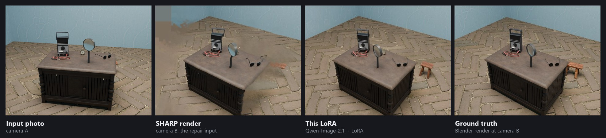

  

Test scene t2, which was not used for any training or selection decision.

# Splat-repair LoRA

A LoRA for [Qwen-Image-2.1](https://huggingface.co/Qwen/Qwen-Image-2.1) that repairs a far view rendered from a single-photo 3D Gaussian splat reconstruction ([SHARP](https://github.com/apple/ml-sharp)).

It fills holes and smears in the parts of the view the photo never saw, using the original photo as a reference.

Made by Abdulaziz Aljman for a COMP90044 Research Methods project at the University of Melbourne (October 2026).

## Why

SHARP turns one photo into a 3D Gaussian splat. Move the camera away from where the photo was taken and the parts the photo never saw come out as holes and smears. An image-edit model can paint them back in: [dx8152's Qwen-Image-Edit-2511-Gaussian-Splash](https://huggingface.co/dx8152/Qwen-Image-Edit-2511-Gaussian-Splash) LoRA showed that, and it was the starting point for this project. This LoRA does the same job on Qwen-Image-2.1, trained on SHARP's actual renders paired with the true view from Blender.

## Use

File: `splat_repair_human_qwen21_e23.safetensors` (rank 8, alpha 8, 42 MB). Put it in ComfyUI's `models/loras/`.

Each repair takes two images and a prompt:

| Input | What it is |
| --- | --- |
| **Image 1** | SHARP's render at the new camera |
| **Image 2** | the original photo |
| **Prompt** | a short, plain description of what the hidden or broken parts should look like (see `examples/`) |

The prompt for the scene at the top, from `examples/t2_prompt.txt`:

> The right end of the cabinet table and the floor behind it got smeared. There's a little rustic wooden stool with an orange-brown top just past the table's right end, and the herringbone brick floor and pale blue walls carry on around it and on the left side of the room.

### ComfyUI

`workflow_api.json` is the API-format graph used for every result below. Load the two images and write the prompt.

| Setting | Value |
| --- | --- |
| Steps | 25 |
| CFG | 1.0 |
| Sampler / scheduler | euler / simple |
| LoRA strength | 1.0 |

It expects the Qwen-Image-2.1 nodes (`TextEncodeQwenImage21`, `QwenImage21Cache`) and the int8 model files named in the graph; swap in your own model files as needed.

## Compared with the previous LoRA

The baseline is the configuration used before this project: Qwen-Image-Edit-2511 with **[dx8152/Qwen-Image-Edit-2511-Gaussian-Splash](https://huggingface.co/dx8152/Qwen-Image-Edit-2511-Gaussian-Splash)** (Apache-2.0), 4-step Lightning sampling and that LoRA's default prompt. That LoRA was the starting point for this idea: it showed that an image-edit model can repair SHARP renders. All credit for it goes to dx8152.

Each sheet, left to right: ground truth from Blender | SHARP's render | previous configuration | this LoRA. Test scenes t1-t5 were not used for any training or selection decision.

Validation scenes (these were used to pick the epoch and caption style, so their scores are optimistic): [x001](compare/x001.jpg), [y05](compare/y05.jpg), [y18](compare/y18.jpg), [y31](compare/y31.jpg).

## Scores

PSNR in dB against the true Blender view, whole frame / only the pixels the photo never saw. Higher is better.

| Scene | SHARP render | Previous (2511 + Gaussian-Splash) | Qwen-Image-2.1, no LoRA, detailed prompt | Qwen-Image-2.1, no LoRA, same prompt | This LoRA |
| --- | ---: | ---: | ---: | ---: | ---: |
| t1 | 22.8 / 23.3 | 19.1 / 19.5 | 20.1 / 20.1 | 20.2 / 20.2 | 24.0 / 25.0 |
| t2 | 19.9 / 18.8 | 19.3 / 19.6 | 16.1 / 18.3 | 16.9 / 18.9 | 21.1 / 22.0 |
| t3 | 18.1 / 17.9 | 16.8 / 17.6 | 13.7 / 14.3 | 17.7 / 18.3 | 17.7 / 19.1 |
| t4 | 18.1 / 19.7 | 16.3 / 20.3 | 15.3 / 12.9 | 15.9 / 16.8 | 16.8 / 20.7 |
| t5 | 20.0 / 18.6 | 18.1 / 17.8 | 16.6 / 17.0 | 14.7 / 15.3 | 19.4 / 18.6 |
| **mean, test** | **19.78 / 19.65** | **17.90 / 18.95** | **16.36 / 16.52** | **17.06 / 17.92** | **19.80 / 21.08** |
| mean, validation | 19.26 / 17.52 | 16.43 / 15.28 | 15.87 / 15.52 | 15.84 / 14.97 | 19.68 / 18.76 |

Read these honestly:

- One training seed and one sampling seed per scene, on 5 test scenes. In the unseen region this LoRA is +1.43 dB over SHARP's render (4 of 5 scenes), but the 95% interval (-0.03 to +2.89 dB) includes zero. Over the whole frame it is level with SHARP's render, and SSIM is lower on every scene.
- Against the previous configuration it has higher PSNR on all 9 scenes. That comparison changes the base model, the LoRA, the step count and the prompt all at once, so it compares two setups, not two LoRAs. The previous configuration was also fed a hole-filled version of the SHARP render.
- With the same human prompt and no LoRA, the base model scores 17.06 / 17.92 dB on the test scenes. This LoRA is higher on all 5 test scenes, by 2.74 dB over the whole frame and 3.16 dB in the unseen region (95% interval 1.35 to 4.98), and SSIM is also higher on all 5 (0.546 vs 0.450). That is the cleanest measure of what the LoRA itself adds; it is still one seed on 5 scenes.
- All scenes are synthetic (Blender + Poly Haven). Real photos have not been tested.

## Training

1. **Base.** Qwen-Image-2.1 (unified generation and editing model).
2. **Data.** 38 pairs from Blender scenes built from CC0 [Poly Haven](https://polyhaven.com) assets. Input = SHARP's actual render at a moved camera plus the photo; target = the true Blender render at that camera.
3. **Captions.** Human-style descriptions of what needs fixing. This beat a detailed object-by-object caption and a constant "fix this" caption on the validation scenes (one seed each, so this ranking is preliminary).
4. **Trainer.** [Fizgig](https://github.com/shootthesound/Fizgig), Fast preset, AdamW 8-bit, rank 8. Epoch 23 of 40 was chosen on the validation scenes.

## Dataset

`dataset/` holds all 47 scenes (Git LFS, about 223 MB):

| Folder | Contents |
| --- | --- |
| `photo/` | the input photo at camera A |
| `splat/` | SHARP's render at the moved camera B (the repair input) |
| `target/` | the true Blender render at B |
| `unseen/` | mask of the pixels at B the photo never saw |
| `fake/` | a simulated render (photo warped with true depth), kept for comparison; it is too clean to replace SHARP's output |
| `meta/` | per-scene settings, camera move and SHARP scores |
| `captions/` | `<id>.human.txt`, `<id>.detail.txt` and the constant caption |

Splits: test `t1`-`t5`; validation `x001`, `y05`, `y18`, `y31`; every other scene is training. Scene specifications were drafted by language-model agents and have not been hand-checked. The SHARP renders are covered by Apple's research licence, so the dataset is for research use only.

## Credits

- **Previous configuration and inspiration:** **dx8152**, [Qwen-Image-Edit-2511-Gaussian-Splash](https://huggingface.co/dx8152/Qwen-Image-Edit-2511-Gaussian-Splash); 4-step sampling from [lightx2v Qwen-Image-Edit-2511-Lightning](https://huggingface.co/lightx2v/Qwen-Image-Edit-2511-Lightning).
- **SHARP** by Apple ([apple/ml-sharp](https://github.com/apple/ml-sharp); Mescheder et al., ICLR 2026). Training inputs were produced with it, under its own research licence.
- **Scene assets:** [Poly Haven](https://polyhaven.com), CC0.
- **Trainer:** [Fizgig](https://github.com/shootthesound/Fizgig) by shootthesound.

## Licence

This LoRA is derived from **Qwen-Image-2.1**, which is released under the [Qwen Research License Agreement](https://huggingface.co/Qwen/Qwen-Image-2.1/blob/main/LICENSE). Use of this LoRA is subject to those terms (research use). The dataset is for research use only, because the SHARP renders in it are covered by Apple's research licence.
