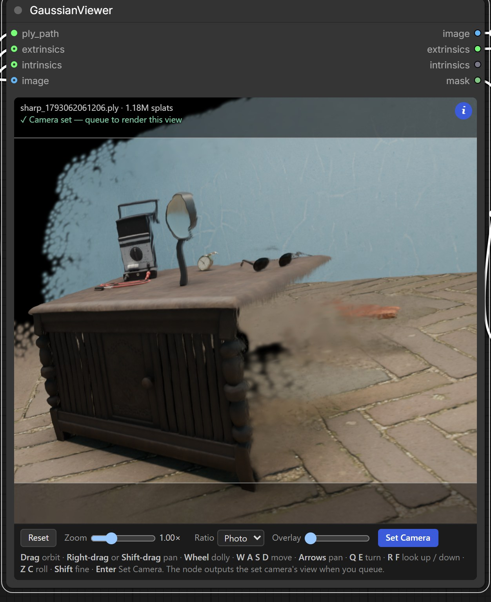

# GaussianViewer (rebuild) for ComfyUI

**Based on [CarlMarkswx/comfyui-GaussianViewer](https://github.com/CarlMarkswx/comfyui_GaussianViewer)**, rebuilt from scratch. Orbit a Gaussian-splat PLY inside the node and press **Set Camera**. The node then outputs that view at the photo's full resolution, with a hole mask and the camera matrices.

It was made to pick the far view for the [splat-repair LoRA](../README.md) in this repository, but it works with any binary PLY splat.

<p align="center"></p>

<p align="center"></p>

The pack has three nodes.

| Node | What it does |
| --- | --- |
| **GaussianViewer** | shows the splat, lets you set a camera, and outputs that view, its hole mask and the camera |
| **Fill Splat Holes** | fills the holes by smearing in the surrounding colours (push-pull), the fill the splat-repair LoRAs were trained on |
| **Extrinsics to Pose** | turns a world-to-camera matrix into a position and pitch, yaw and roll |

GaussianViewer keeps the original's node name, its inputs and its first three outputs, so existing workflows (for example SHARP → GaussianViewer → image edit) load unchanged.

## Install

Only one GaussianViewer pack can be enabled at a time, because both register the node `GaussianViewer`. If you have the original, disable or uninstall it first. In ComfyUI Manager, find **ComfyUI GaussianViewer** and press Disable, or rename its folder in `ComfyUI/custom_nodes/` so it ends in `.disabled`.

Then pick one of these and restart ComfyUI:

- In ComfyUI Manager, open the Custom Nodes Manager, search for **GaussianViewer (rebuild)** and install it.
- Run `comfy node install gaussian-viewer-rebuild`.
- Download `comfyui-gaussian-viewer-2.0.0.zip` from the [v1.1 release](https://github.com/aaljman/splat-repair-lora/releases/tag/v1.1) and unpack it into `ComfyUI/custom_nodes/`.

The pack needs no extra Python packages. To make splats from a photo, also install [ComfyUI-Sharp](https://github.com/PozzettiAndrea/ComfyUI-Sharp) (registry ID `comfyui-sharp`).

The pack ships two example workflows, listed in ComfyUI's template browser under this pack. You can also drag them onto the canvas.

- `SHARP_to_GaussianViewer.json` goes from a photo through SHARP to the viewer and its previews.
- `SHARP_to_splat_repair_LoRA.json` is the full pipeline. It adds Fill Splat Holes and both splat-repair LoRAs, and needs the Qwen-Image-2.1 files and the [LoRAs](https://github.com/aaljman/splat-repair-lora/releases/tag/v1.1).

## What changed from the original

| | Original | This rebuild |
| --- | --- | --- |
| Renderer | gsplat.js bundle (2,500 lines) in an iframe | own WebGL2 renderer (about 260 lines), no iframe |
| PLY parsing | main thread, 663 ms for a 1.18M-splat SHARP file (UI frozen) | web worker, 199 ms, UI stays responsive |
| Re-running the node | downloads and parses the PLY again every time | skips the load when the file has not changed (and the browser caches it) |
| Idle cost | redraws every frame, forever, per node | draws only when the view changes |
| Draw | fixed 1184×880 canvas whatever the node size | node size × device pixel ratio; 2 to 3 ms per frame for 1.18M splats on an RTX 3090 |
| Depth sort | gsplat.js worker | 16-bit counting sort in a worker, about 14 ms for 1.18M splats |
| Colour | blends sRGB | blends in linear light, like SHARP's own renderer (half-float target, sRGB fallback) |
| Output image | screenshot of the preview canvas | rendered offscreen at the output size with the exact intrinsics |
| Camera storage | server memory, lost on restart | in the workflow (hidden `camera` widget) |
| Changing the input | outputs the old screenshot until you press Set Camera again | queue once, and the server asks the open tab to render the stored camera on the new splat |
| Holes | no mask | `mask` output, plus the Fill Splat Holes node |

Timings are from headless Edge on the same file. The new renderer matches a reference PyTorch 3DGS rasteriser on the same camera to 55.5 dB PSNR (alpha error 0.0006).

## Use

1. Connect `ply_path`, and SHARP's `extrinsics` and `intrinsics`, which set the starting camera and the output size. Queue once and the viewer loads the splat. The nodes downstream wait, because no camera is set yet.
2. Frame a view and press **Set Camera** (or Enter).
3. Queue again, and the node outputs the view. If the PLY changes later, queue once more. The node renders the stored camera on the new splat.

The **i** button (top right) shows or hides the buttons and the help line, and the viewer remembers your choice. The status line at the top says whether the view on screen is the one that will be rendered.

| Input | |
| --- | --- |
| Drag | orbit around the target |
| Right-drag / Shift-drag | pan |
| Wheel | dolly (keeps going past the target); Shift for fine steps |
| W A S D, arrows | move |
| Q E / R F / Z C | turn / look up and down / roll, about the camera itself |
| Shift | fine (0.1×) |
| Enter | Set Camera |

The buttons behind **i** are **Reset** (back to the photo's camera), **Zoom** (focal length), **Ratio** (crops the photo's frame), **Overlay** (opacity of the optional reference `image`) and **Set Camera**.

## Outputs

| Output | |
| --- | --- |
| `image` | the view, over black |
| `extrinsics` | 4×4 world-to-camera matrix, OpenCV axes (x right, y down, z forward), the same convention as SHARP |
| `intrinsics` | 3×3 intrinsics of the output image |
| `mask` | 1 where the splat left a hole, 0 where it is solid (same convention as Load Image's mask) |

GaussianViewer caches renders in `ComfyUI/input/gaussian_viewer/` and keeps the newest 64. Re-queuing the same camera on the same file therefore does not need the browser.

Fill Splat Holes takes `image` and `mask` from GaussianViewer. Pixels with coverage below `threshold` (default 4/255) count as holes. It averages the solid pixels down a pyramid of halved images and pushes the coarse colours back up into the gaps, blending in linear light, and leaves solid pixels untouched.

## Breaking changes from the original (v1)

- The `extrinsics` output is now the 4×4 **world-to-camera** matrix in OpenCV axes, the same convention as SHARP's nodes. Before, it was camera-to-world in gsplat.js's axes.
- Extrinsics to Pose now reads a world-to-camera matrix. Its angles follow the viewer's order: yaw > 0 turns right, pitch > 0 looks up, then roll.
- Saved cameras from v1 don't carry over, because v1 kept them in server memory. Press Set Camera once per node.
- Camera presets, the splat-scale multiplier, and the copy of each render saved to `output/` are gone.
- On the first run the nodes downstream are skipped until a camera is set. The viewer still loads the splat, so you can frame a view.

## Known limits

- Rendering a new camera or a new splat needs a ComfyUI tab with the workflow open. A run with no browser, for example through the API, works only when that camera and splat are already in the render cache. Otherwise it fails after 10 s with a clear message.
- The viewer uses only colour band 0 (`f_dc_*`, or `red`/`green`/`blue`), so it ignores view-dependent colour. SHARP's output has only band 0.
- It reads only binary little-endian PLY. Compressed PLY, `.splat` and `.ksplat` files don't load.
- It needs WebGL2. Without float render targets the viewer falls back to blending in sRGB.

Tested with ComfyUI 0.39.0 (frontend 1.55.14) in Microsoft Edge and Firefox, on an RTX 3090, with SHARP PLYs from ComfyUI-Sharp.

## Files

```
__init__.py            node registration
nodes.py               GaussianViewer, Fill Splat Holes, Extrinsics to Pose, and the HTTP routes the viewer uses
web/gaussian_viewer.js the node UI: camera, controls, Set Camera, render requests
web/splat_renderer.js  WebGL2 splat renderer
web/splat_worker.js    PLY parsing and depth sorting
example_workflows/     the two example workflows
pyproject.toml         Comfy Registry metadata
```

## Credits and licence

This pack is based on [CarlMarkswx/comfyui-GaussianViewer](https://github.com/CarlMarkswx/comfyui_GaussianViewer). Thanks to its authors for the original node and its idea. The rebuild is GPL-3.0-or-later, like the original (see `LICENSE`). That licence covers this folder only. The LoRAs and the dataset in the rest of the repository have their own terms.
